# RentKit Endterm report — draft for completion

Course: Web Technologies 1  
Project: RentKit equipment rental website  
Repository: https://github.com/issait1701-code/RentKIT  
Verified publication URL: [fill in after deployment]  
Participants: Saitov Islambek; Jomart Akylbek  
Group: IT-2507  
Submission date: 08.11.2026 (updated 15.11.2026)

## Objective

Extend the existing Midterm equipment rental site into an interactive Endterm submission while preserving its five pages, visual identity and original rental functionality.

## Implemented functionality

| Requirement | Implementation / evidence |
| --- | --- |
| Five complete pages and shared navigation | `index.html`, `kits.html`, `kit-details.html`, `order.html`, `rent.html`; active `aria-current` link |
| Array with at least eight objects | `js/data.js`: eight kits with ID, name, category, image, package prices, contents, bring and description |
| DOM-generated catalogue | `js/catalog.js`: `createElement`, `textContent`, loops, `replaceChildren` |
| Search, filters, sorting, empty state | Combined multiword search, category, budget, price/name sort, reset and announced result count |
| Computed rental value | Shared validated package prices, 1/3/7 days, delivery once, return date |
| Bootstrap form and JavaScript validation | Kit, pickup date, duration, name, email, phone and agreement; optional comment; per-field inline errors |
| Events and custom functions | `click`, `input`, `change`, `submit`; pure search/calculation/validation functions and UI functions |
| Three jQuery effects | FAQ `slideToggle`, confirmation `fadeIn`, anchor `animate`; `stop(true,true)` and reduced motion |
| Useful original addition | Kit-specific personal packing checklist, progress counter, reset and optional browser persistence |
| Responsive and accessible UI | Semantic headings, image alt, labels, skip link, keyboard focus, invalid-field state and live announcements |
| Organization and documentation | Separate CSS/JS/assets, vendor license information, README, credits, editable Word report, report text and screenshots |

## Endterm update 2 (15.11.2026)

| Change | Where |
| --- | --- |
| Bug fix: kits 5–8 had no picture on *Inside the Kits* | `js/details.js` now builds the same figure + list + checklist layout as kits 1–4 |
| Four new original illustrations, one per smaller kit; branded photo replaced | `images/light-kit.svg`, `solo-kit.svg`, `projector-kit.svg`, `speaker-kit.svg` |
| Quick view dialog (developed from the team's `openDetail` draft) | `js/catalog.js` → `openModal()`, `openDetail()`; styles in `css/kits.css` |
| Rental period picker with total, saving and delivery; Book link passes `kit`, `days`, `method` | `js/catalog.js`, `js/order.js` |
| Saved kits (♥) with header counter and filter | `js/site.js` (`RentKitFavorites`), `js/catalog.js` |
| Compare up to three kits | `js/catalog.js` → `openCompare()` |
| Dark theme, toast, back-to-top, sticky header | `js/site.js`, `css/styles.css` |
| Pickup shows our address (Kabanbay Batyr Ave 62); Delivery opens a validated address form | `order.html`, `js/order.js` → `syncMethod()`, `js/data.js` → `validate()` |
| Header always on top; ☰ menu below 900 px | `js/site.js`, `css/styles.css` |
| Home statistics counted up with jQuery `animate` | `js/home.js`, `index.html` |
| Repeatable tests | `tests/data.test.js`, `tests/browser_check.py` |

**jQuery used in the update:** `fadeTo`/`fadeOut` (dialog overlay), `animate` on `opacity`/`marginTop` (dialog), `slideDown`/`slideUp` (compare bar), `delay().animate()` (card fade-in), `animate` on a plain object (number counter), `stop(true, true)` everywhere to avoid queues. All animations are skipped when the user prefers reduced motion.

**Accessibility of the dialog:** `role="dialog"`, `aria-modal`, `aria-labelledby`, focus moved into the dialog and trapped with Tab/Shift+Tab, Esc and overlay click close it, focus returns to the button that opened it; the period picker is a `radiogroup` with arrow-key support.

### Screenshots

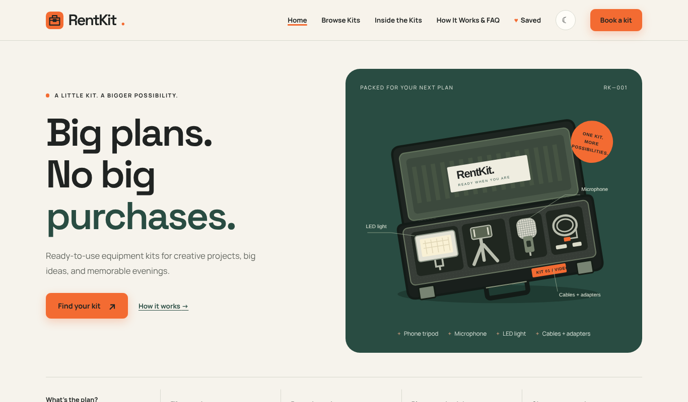
*1. Home page with sticky header, saved counter and theme switch*

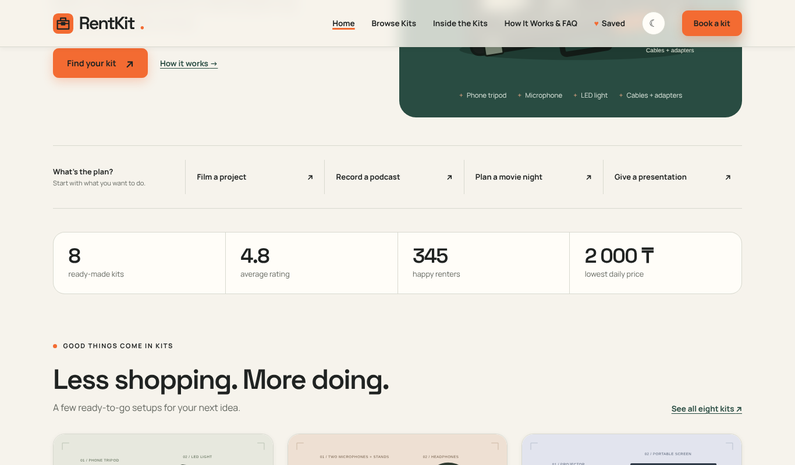
*2. Statistics calculated from the kit data*

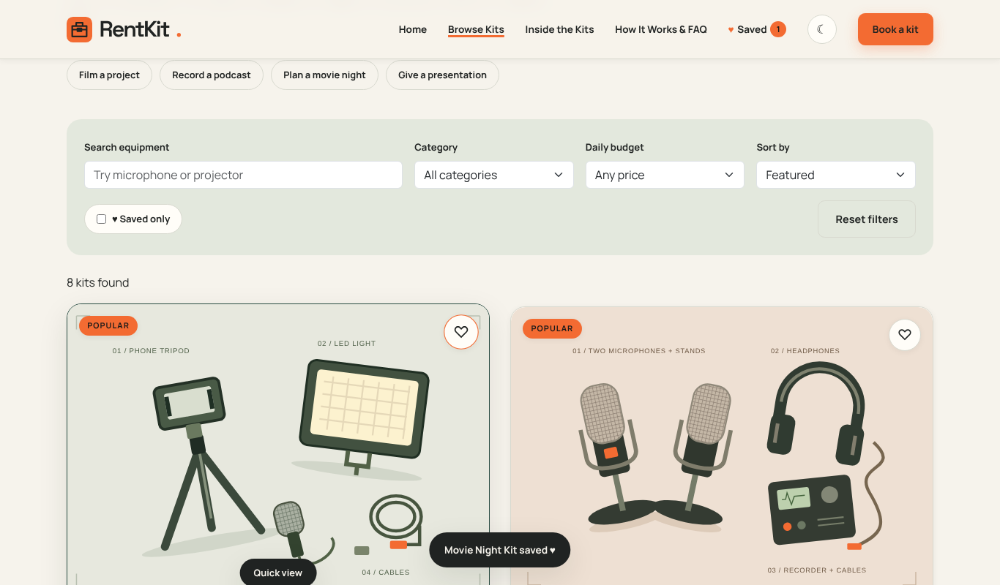
*3. Redesigned catalogue: rating, chips, Popular badge, save and compare*

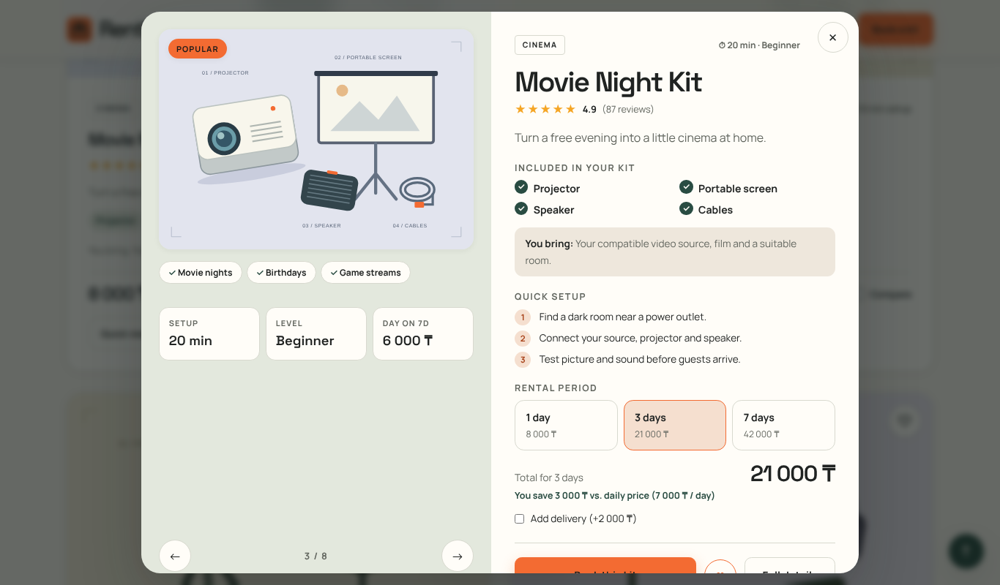
*4. Quick view: 3-day period selected, total and saving*

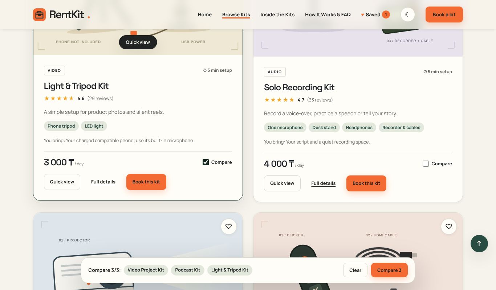
*5. Compare bar with three selected kits*

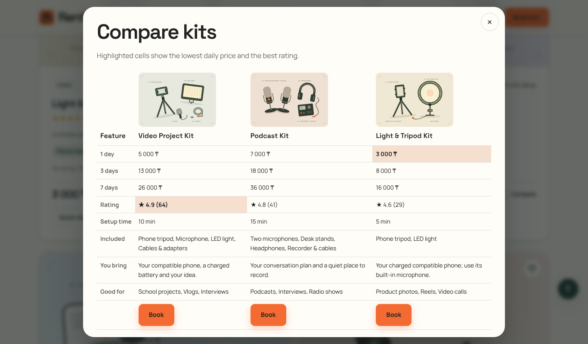
*6. Comparison table with best price and rating highlighted*

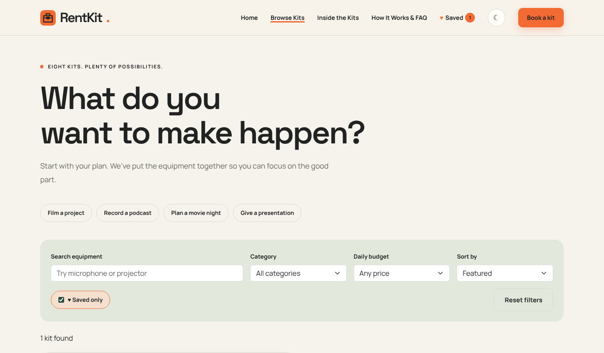
*7. Saved kits filter*

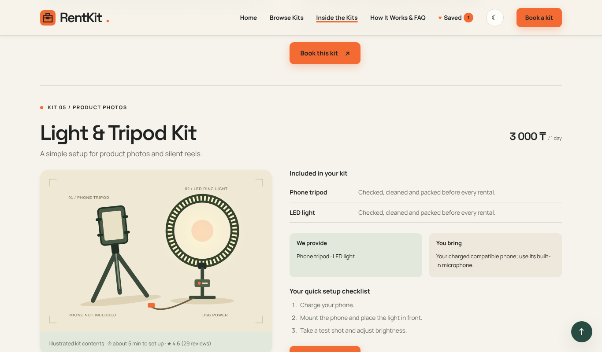
*8. Fixed: kit 05 on Inside the Kits now has its illustration*

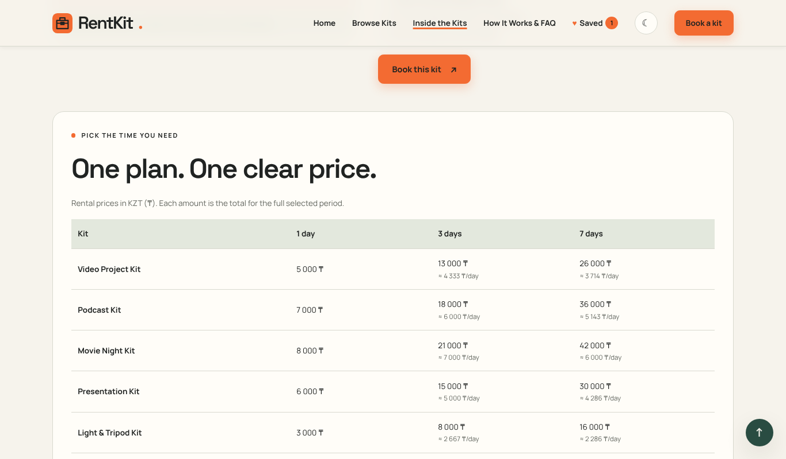
*9. Price table with per-day value*

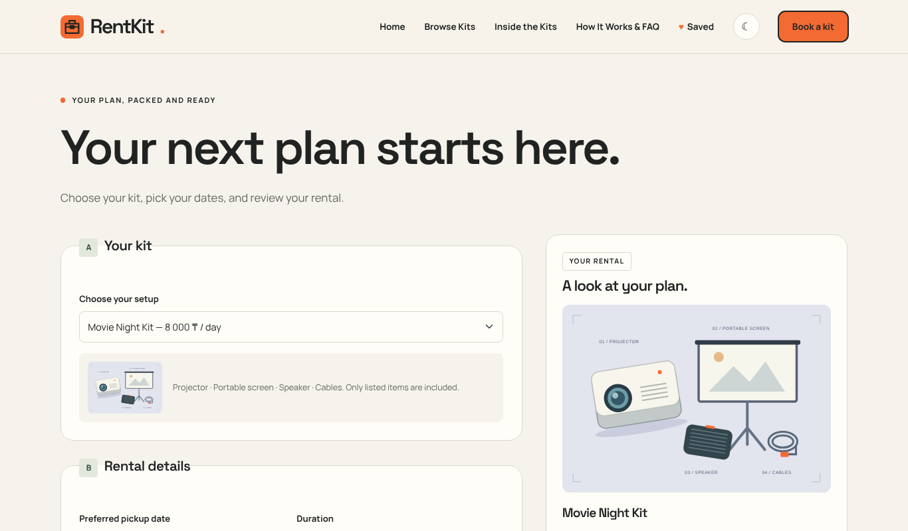
*10. Order form pre-filled from quick view (kit, 3 days, delivery)*

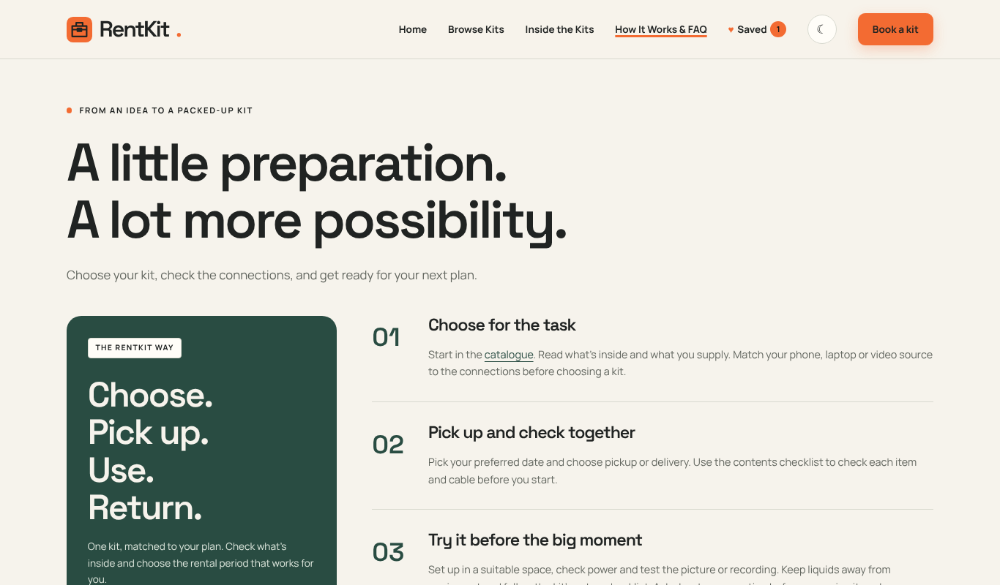
*11. How It Works & FAQ*

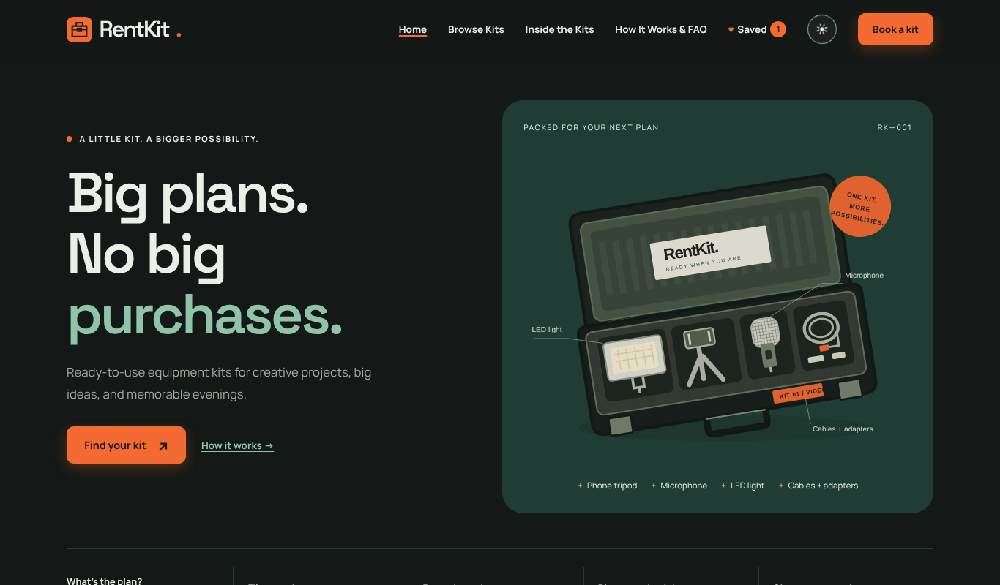
*12. Dark theme — home*

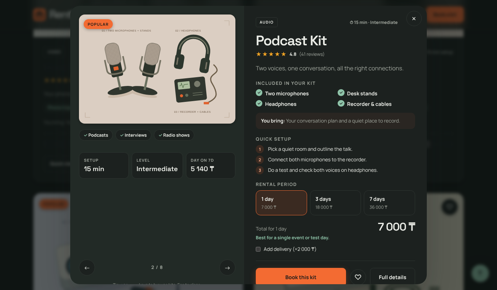
*13. Dark theme — quick view*

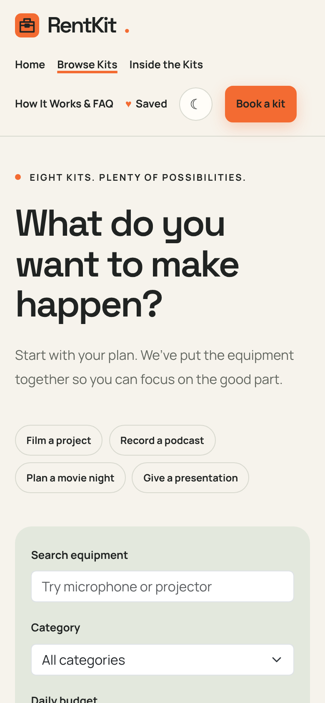
*14. Mobile catalogue (390 px)*

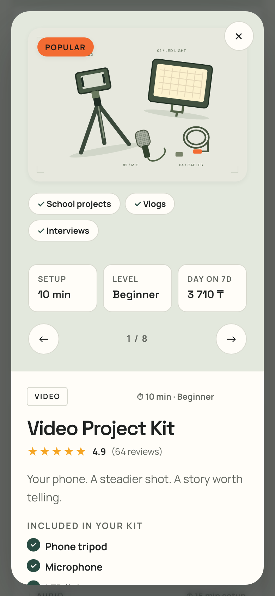
*15. Mobile quick view*

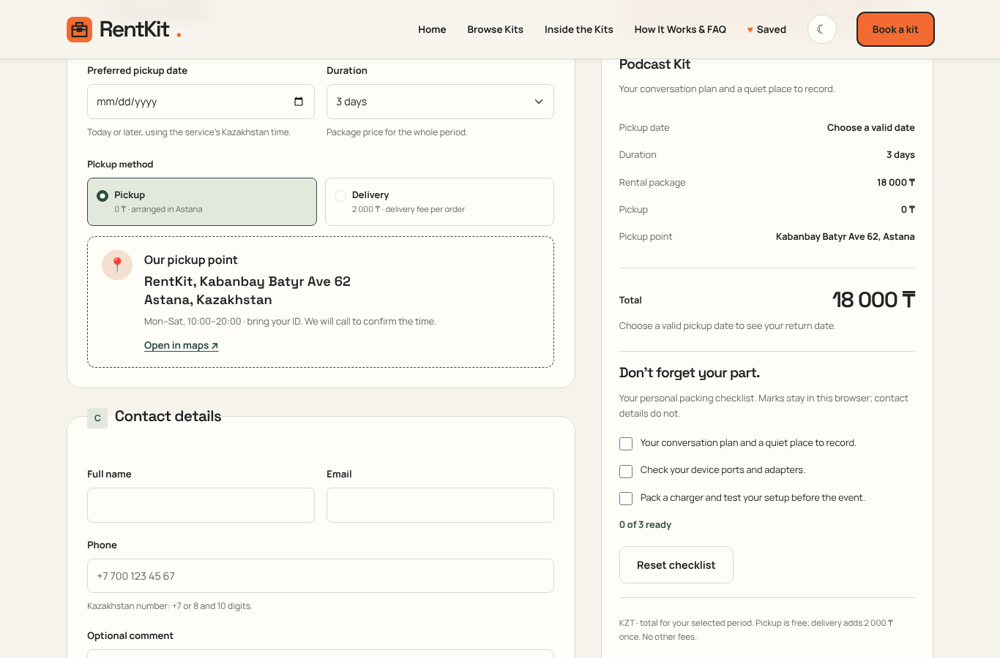
*16. Pickup shows our address*

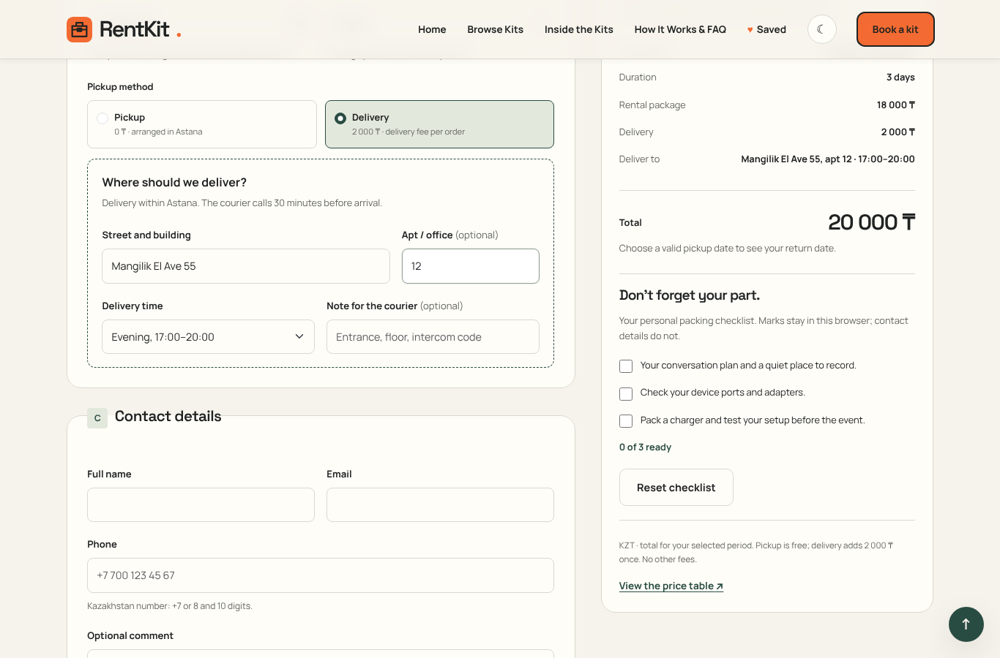
*17. Delivery opens the address form; the summary shows the address*

## Pages and files changed

- `index.html`: shared scripts, catalogue count, explicit fictional-story label and demo footer.
- `kits.html`: controls and DOM mount points replace handwritten catalogue cards.
- `kit-details.html`: four original detailed sections retained; extra kit descriptions and eight-row price table rendered from shared data.
- `order.html`: phone field, submit workflow, inline-error integration, return date, checklist and demo explanation.
- `rent.html`: original process/conditions/native FAQ retained, enhanced by shared jQuery script.
- `css/styles.css`, `css/kits.css`, `css/order.css`: accessible interaction states, filter layout and checklist styling.
- `js/data.js`, `js/catalog.js`, `js/details.js`, `js/site.js`: new separated responsibilities; `js/order.js` revised around shared data.
- `vendor/jquery-3.7.1.min.js`: local jQuery dependency with its copyright and license reference preserved in the bundled header.
- `docs/README.md`, `docs/CREDITS.md`: setup, current structure, sources and AI disclosure.
- `docs/ENDTERM-REPORT-updated.md`: updated report text.
- `docs/RentKIT_Endterm_Report_updated.docx`: updated editable Word report; a separate output preserves the currently open original.
- `screenshots/endterm/`: fifteen saved Endterm screenshots.

Existing images, fonts, original screenshots and the user-edited Midterm Word document are retained.

## Technical decisions

The site remains buildless HTML/CSS/JavaScript with Bootstrap. It does not introduce a new framework or replace the existing project. Classic deferred scripts work with a simple local file or static host. A namespaced `RentKit` object supplies a single data source and testable pure functions. Cards use `textContent` rather than interpolating user input into HTML.

The calculator preserves original package pricing. Invalid IDs, unsupported periods and pickup methods return no quote. Calendar dates are checked for real existence and compared with the date in `Asia/Qyzylorda`; return arithmetic uses UTC calendar days to avoid daylight-saving shifts. Client-side validation is suitable for a demonstration and must be repeated on a server if real booking is added.

Validation keeps visible errors beside the relevant controls, sets `aria-invalid` and links descriptions with `aria-describedby`. Submission focuses the first invalid field. Success clears the form and presents the calculated summary without a network request. Only packing marks are saved locally, with graceful fallback when storage is unavailable.

Native HTML FAQ remains usable without jQuery. Animation handlers finish previous animations before starting new ones and respect reduced motion. Local assets allow the normal site to run without external CDN requests.

## Verification

Latest run on 15 November 2026: `node --test tests/*.test.js` — 7 passed, 0 failed. `python tests/browser_check.py` in headless Chrome — 0 failures (5 pages × 375/768/1280 px: no JavaScript errors, no broken images, no horizontal scroll; quick view, saved kits, compare and pre-filled order flows).

During the earlier implementation run on 8 November 2026, 181 static checks completed with 0 errors and 220 browser assertions passed with 0 failures. These are historical results from the development session, not a new test execution or verification of the current submission.

That run covered search, combined filters, sorting, form validation, all 48 kit/period/delivery combinations, DOM events, checklist persistence, links and runtime errors. All five pages were checked in headless Chrome at 375, 768 and 1280 CSS pixels. No horizontal overflow or uncaught JavaScript errors were detected in that run. Fifteen saved screenshots remain in `screenshots/endterm/`.

The automated test scripts, machine-readable results and separate testing notes were subsequently removed from the workspace. The current submission therefore does not include a repeatable automated test suite or its original result log. The historical counts cannot be independently reproduced from the remaining files alone. Physical devices, Safari/Firefox and a full screen-reader audit were not covered by the earlier checks.

For the current copy, manually verify all five pages, combined search and filters, empty results, form errors and correction, successful form reset, package pricing, delivery, return dates and checklist persistence. Review layouts at 375, 768 and 1280 pixels and check the browser console. These are verification instructions, not a claim that a new check has been performed.

## Current submission structure

The workspace contains the five HTML pages; `css/`, `js/`, `images/`, `fonts/`, `vendor/`; `docs/` with README, credits, report files and the archived Midterm Word document; and the original and Endterm screenshot folders. The removed Midterm README, test utilities, test log and report-generation utility are not required to run the website and are not included as deliverables. To meet the original requirement for submitted repeatable tests, the automated test suite would need to be restored separately.

## Running the current project

Open `index.html` directly, use VS Code Live Server, or serve the repository root with `python -m http.server 8000` and visit http://localhost:8000. No npm installation or build step is required. The documentation is stored in `docs/`. Run a server from the repository root, not from the documentation folder. The Word report can be edited directly; no report-generation utility is included.

## Team responsibility split

The following is an approximately equal allocation of responsibility for the project and defense; it does not claim exclusive authorship of every line of code. AI assistance is disclosed separately.

| Participant | Areas of responsibility | Main files | Defense focus |
| --- | --- | --- | --- |
| Saitov Islambek | Catalogue and shared equipment data; DOM cards, search, filters and sorting; catalogue and rental-process pages; jQuery effects and animation queue handling | `js/data.js`, `js/catalog.js`, `js/site.js`, `kits.html`, `rent.html`, `css/kits.css` | Dataset, DOM generation, combined filtering, sorting, `slideToggle`, `fadeIn`, `animate`, `stop(true,true)` |
| Jomart Akylbek | Booking form and validation; rental calculator, delivery and return dates; packing checklist and local storage; home and equipment-details pages; shared styling, responsive layouts and accessibility | `js/order.js`, `js/details.js`, `order.html`, `index.html`, `kit-details.html`, `css/order.css`, `css/styles.css` and other page styles | Validation rules, event handlers, package prices, return dates, checklist persistence and responsive behavior |

Both participants share responsibility for reviewing integration, checking links and user scenarios, and preparing the report and presentation. The jQuery part is assigned to Saitov Islambek, as specified by the team. This approximately equal split describes responsibility rather than measured hours or line counts.

## Sources and AI disclosure

See `docs/CREDITS.md` for image, SVG illustration, font, Bootstrap and jQuery sources and license information.

OpenAI Codex helped with project ideas, the equipment-rental concept and interactive feature suggestions, original SVG illustrations, repository review and implementation. Its assistance included generated and revised HTML, CSS and JavaScript for the dataset, DOM catalogue, search, filtering, sorting, form validation, calculator, return dates and packing checklist; styling, responsive and accessibility suggestions; jQuery integration and animation logic; debugging and earlier automated checks; and drafting and revising the README, credits, report, Word document and English defense. AI assistance included code as well as explanations. Team members are responsible for checking the final submission and understanding the code they present.
